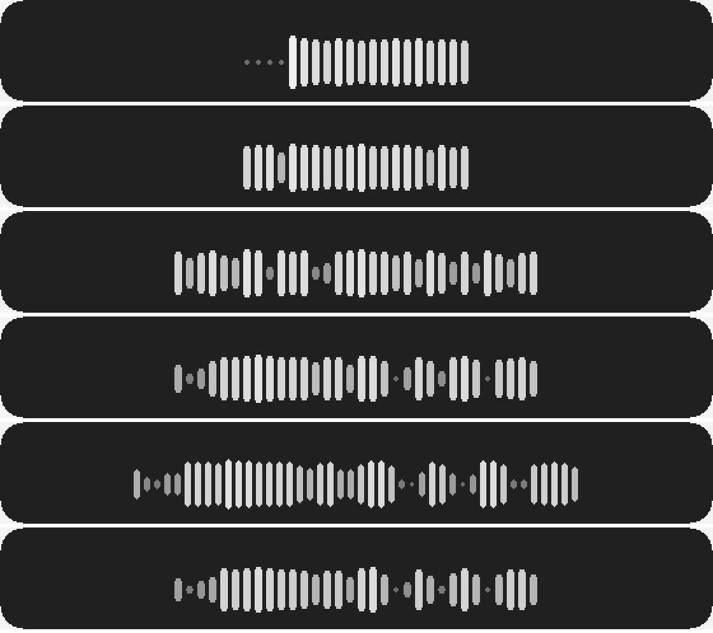
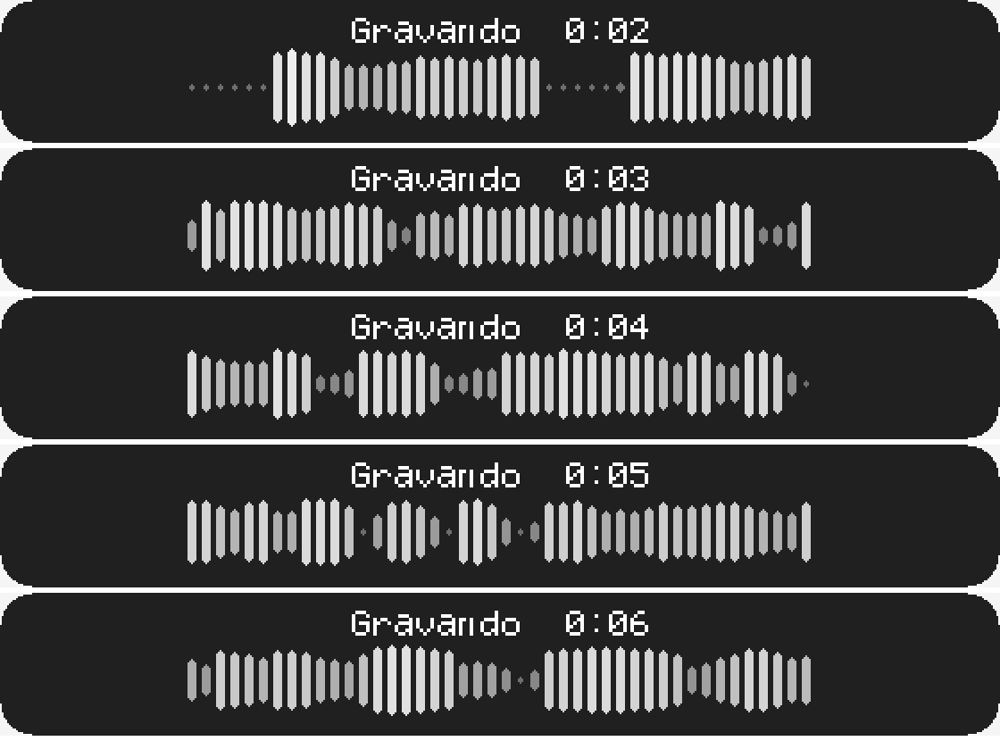
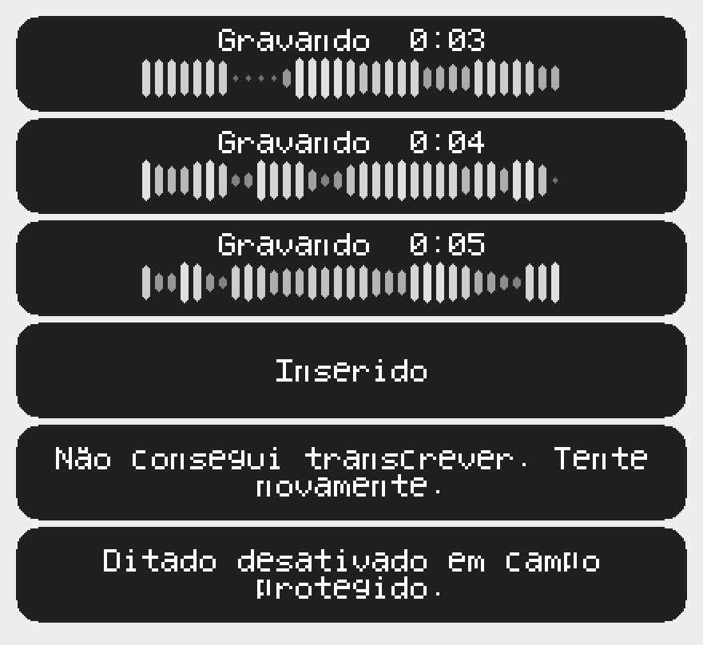

# ADR-014 — A onda do overlay passa a ser logarítmica e espelhada

Status: Accepted
Data: 2026-09-26
Contexto: Sprint 4, no primeiro ditado real com o gatilho `Ctrl+Win` do ADR-013

## O problema, encontrado usando o produto

Mauro, testando o ditado depois da troca de gatilho:

> "ele mostrou gravando, a onda se mexeu conforme a voz falava mas acho que o
> movimento podia ser mais intenso, mais interessante."

Parece feedback de gosto. Não é. Medido, é defeito.

## A medição

`audio.Frame.RMS` chega ao overlay normalizado em `[0,1]` como fração do fundo de
escala int16, e `barHeight` mapeava isso **linearmente** sobre a altura da barra:

```go
h := min + int(amplitude*float64(max-min))   // min=6, max=26
```

Rodando as 46 amostras de `testdata/asr-dataset/audio` — gravadas no microfone e
no ganho reais desta máquina — pela própria função de produção, com o mesmo anel
de 512 quadros que o overlay usa:

| | |
|---|---|
| RMS dos quadros vozeados, p50 | 0,068 (**-23,4 dBFS**) |
| RMS dos quadros vozeados, pico | 0,224 (**-13,0 dBFS**) |
| altura de barra em 86% dos quadros vozeados | **6 ou 7 px**, de 6 a 26 |
| alturas distintas usadas | **5 de 21** |
| espalhamento da onda num frame desenhado (p50) | **2 px de 20 disponíveis** |

**Dois pixels.** A onda usava 10% do curso que tinha. O que ele viu na tela foi
exatamente isso, e a palavra "intenso" descreve o sintoma com precisão.

## Por que linear estava errado por dois motivos independentes

**Físico.** RMS de fundo de escala 1,0 é **inalcançável**. Uma senoide em fundo de
escala tem RMS 0,707; fala tem fator de crista de 3 a 5, então fala com RMS 1,0
estaria clipada muito antes. O mapeamento linear reservava a maior parte do curso
para amplitude que não pode acontecer.

**Perceptual.** Sonoridade é logarítmica. É para isso que o decibel existe.

## A decisão

**1. O mapeamento passa a ser em dBFS**, espalhando `[-48, -14]` sobre o curso da
barra (`WaveFloorDBFS`, `WaveCeilDBFS` em `layout.go`).

O piso em -48 fica bem abaixo do fundo entre palavras (p50 medido em **-67 dBFS**,
p99 em -31), então silêncio continua lendo como repouso. O teto em -14 fica logo
acima do pico medido (-13,0): a barra encosta no máximo em sílaba forte sem
saturar o tempo todo — 0,6% dos quadros vozeados chegam ao topo.

São constante, e não configuração: é propriedade de voz captada perto do
microfone, não preferência de quem usa.

**2. A onda passa a ser espelhada** em torno de um eixo horizontal, com barras em
cápsula (ponta arredondada), em vez de retângulos crescendo de uma base.

É a forma que se reconhece como "estou ouvindo sua voz" — gravador de voz, Wispr
Flow, WhatsApp — e tem um efeito colateral útil: 1 px de variação de amplitude
move as duas pontas, então a barra cresce 2 px. O mesmo sinal rende o dobro de
movimento.

**3. O brilho da barra acompanha a altura** (cinza 110 em repouso, 245 no pico).
É a mesma informação que a altura já dá, codificada duas vezes de propósito.

## O número mentiu, e a imagem corrigiu

Com as três decisões acima, a medição dizia: espalhamento de **2 px para 38 px**
(p50), 11 alturas distintas. Eu dei o trabalho por encerrado nesse número.

Aí o overlay foi **renderizado para PNG** — o `Canvas` é Go puro, então o mesmo
desenho que `UpdateLayeredWindow` apresenta pode ser inspecionado sem Windows.




A onda ficou alta e **virou uma cerca**: quase todas as barras do mesmo tamanho.

O erro da medição era de agregação. Os 38 px de espalhamento mediam **silêncio
contra fala**, não a dinâmica DENTRO da fala. Como cada barra resumia o **pico de
256 ms** — mais ou menos uma sílaba inteira — o pico de qualquer sílaba dá quase
sempre o mesmo valor, e as barras empatam.

Um número agregado pode subir 19x enquanto a coisa continua ilegível. Aqui só a
imagem resolveu.

## A quarta decisão: a janela da onda passa a ser por TEMPO

A causa da cerca era o tamanho da janela de histórico. Estava em
`maxAmplitudeSamples = 512`, um anel contado em **quadros** — e quadro não tem
duração fixa: a captura entrega o que `IAudioCaptureClient::GetNextPacketSize`
devolver, que é o período do dispositivo (`wasapi_windows.go`).

Isso é defeito por si só, independente da cerca: 512 quadros valem 5,1 s numa
placa de pacote de 10 ms e 10,2 s numa de 20 ms. Na segunda máquina cada barra
cobriria o dobro de tempo, e a onda viraria uma cerca **sem nada no código
dizendo por quê**.

Agora a janela é `JanelaDaOnda = 1,3 s`, medida por idade da amostra;
`maxAmplitudeSamples` fica só como teto de memória.

`TestOnda_JanelaIndependeDoTamanhoDoPacote` trava isso com três períodos de
dispositivo. Confirmado por mutação — voltando ao descarte por contagem, o
dispositivo de 3 ms retém 3,07 s e o de 10 ms retém 3,99 s, exatamente a
dependência de máquina que o teste existe para impedir.

## A quinta: 44 barras finas, escolhidas olhando

Seis combinações de janela e número de barras foram desenhadas sobre o **mesmo
instante de áudio real** e comparadas lado a lado (`img/ADR-014-variantes.png`).
Venceu 1,3 s em 44 barras de 5 px: **29 ms por barra**, abaixo da duração de uma
sílaba, que é o que faz aparecer o contorno da frase.

A onda passa a ocupar 349 px dos 560 da pílula, contra 177 px.



### O resultado

| | antes | agora |
|---|---|---|
| curso disponível | 20 px | **42 px** |
| tempo resumido por barra | 256 ms (e variável por máquina) | **29 ms, fixo** |
| largura da onda na pílula | 177 px | **349 px** |
| alturas distintas em quadros vozeados | 5 | **11** |

## O que este ADR NÃO decide: a identidade visual

O `ADR-010`, D2 adiou a identidade visual (azul da família Aurora) para "o Sprint
2 com a skill de design". **Isso nunca foi feito.** O overlay continua cinza sobre
quase-preto, e o comentário em `render.go` que prometia o Sprint 2 estava
desatualizado desde então.

O que mudou aqui foi **forma e mapeamento**, dentro da mesma família de cinza. A
cor é decisão de Mauro e continua aberta — está registrada como dívida no próprio
`render.go`, onde quem for mexer na paleta vai ler.

## A lição de teste: 1.025 testes verdes não pegaram isto

O pacote `overlay` tinha teste para `Bars`, e todos passavam com o mapeamento
quebrado. Eles cobriam:

- amplitude `0` e `nil` → altura mínima
- amplitude `1.0` → altura máxima
- amplitude fora de `[0,1]` → recortada
- pico do balde, não a média

Ou seja: **só os extremos**. E os extremos são exatamente os dois pontos em que
linear e logarítmico **concordam**. Nenhum teste olhava o meio do mapeamento, que
é onde fala real vive.

Pior, `TestRender_RecordingDesenhaBarras` era **vacuoso**: procurava um pixel com
`alpha == 255` na faixa da onda, e a pílula preenche essa faixa inteira, opaca. O
teste passava com `drawBars` não desenhando barra nenhuma.

O que entrou no lugar:

- `TestBarHeight_FalaRealUsaOCursoDaBarra` — ancorado nos RMS **medidos** no
  microfone real, exige fração mínima do curso. Confirmado por mutação: com o
  mapeamento linear os três casos falham.
- `TestBarHeight_SilencioFicaEmRepouso` — o outro lado, para o fundo não subir
  junto e matar o contraste.
- `TestRender_AlphaNaoDistingueBarraDePilula` — **prova** a vacuidade do teste
  antigo, renderizando uma fase sem onda e mostrando a faixa cheia de pixel opaco.
- `TestRender_OndaEhEspelhadaEmTornoDoEixo` e `..._CabeNaPilula` — a geometria.
- `TestRender_DiscriminadorDeBarraEhValido` — trava as desigualdades de paleta de
  que os testes de onda dependem, para uma mudança de cor falhar ali em vez de
  fazer os testes de onda mentirem.

E a lição mais cara deste ADR não é sobre teste, é sobre **medição**: o
espalhamento subiu 19x e a onda continuou ilegível. Métrica agregada que mistura
dois regimes — aqui, silêncio e fala — pode melhorar muito enquanto o que
importa não muda. Renderizar para PNG custou poucos minutos e foi o que
resolveu; o desenho é Go puro justamente para isso ser barato.

## A sexta: a pílula encolhe 25%

Mauro, vendo o resultado renderizado:

> "Eu gostei bastante desse design aí. só acho que ela estava aparecendo grande
> demais na tela. pode ser uns 25% menor."

`560x80` passou a `420x60` — **75% da largura, 56% da área**.

O que segurava os 560 px era a maior mensagem de `phase.go` numa linha só: "Não
consegui transcrever. Tente novamente." tem 42 runes, e 42 runes na escala de
texto usada precisam de ~540 px. Diminuir a fonte não era opção — a escala 1 do
bitmap 5x7 fica ilegível.

Mauro autorizou encurtar ("se o problema for a mensagem, tira a mensagem"), mas
**não foi preciso**: `WrapText` quebra em até duas linhas, sempre em espaço,
nunca no meio da palavra. A largura passa a ser ditada pela metade mais longa, o
texto da spec fica intacto e o feedback de erro continua existindo.



A onda acompanhou a proporção: 33 barras de 5 px ocupam 261 px, os mesmos ~62% da
largura que 44 barras ocupavam na pílula grande. Cada barra passa a resumir 39 ms
— ainda bem abaixo do limite de ~100 ms em que a onda vira cerca.

`TestTodasAsMensagensCabemNaPilula` ficou **mais exigente**, não menos: além de
caber, o texto quebrado tem de conter tudo que a mensagem original dizia. Quebrar
não pode virar um jeito discreto de perder a cauda da frase.

## O design do overlay como um todo continua ruim

Mauro, vendo o resultado (26-set-2026):

> "inclusive o design dessa tua tecla ficou bem ruim. Pode melhorar muito.
> Podemos discutir isso melhor depois."

Concordo, e este ADR **não** resolve isso — ele mexeu só na onda. O que está
visivelmente ruim, para a conversa que ficou marcada:

- **A fonte.** É um bitmap 5x7 desenhado à mão (`font.go`), escalado 2x sem
  suavização. Parece mostrador de calculadora, e em "Gravando" as letras `ri`
  quase se encostam.
- **Não há antialiasing em lugar nenhum.** `canvas.go` diz isso explicitamente,
  como escolha de "correto e legível agora". Toda borda é degrau de pixel.
- **A paleta é provisória** desde o Sprint 1 — cinza sobre quase-preto. É a
  dívida do `ADR-010`, D2 descrita acima.
- **A pílula é fixa em 560x80**, dimensionada pela mensagem de erro mais longa.
  Durante a gravação, que é o estado mais comum, sobra vazio dos dois lados.

Nada disso é decidido aqui. Fica registrado para a discussão não recomeçar do
zero.

## Verificação em máquina real

**26-set-2026, Bloco de Notas** — Mauro:

> "no notepad rodou perfeitamente. Eu gostei mais do tamanho da wave assim do que
> antes."

A onda está validada em uso: o mapeamento logarítmico, a forma espelhada, a
janela por tempo e as 33 barras. `WaveCeilDBFS` não precisou ser mexido — não
saturou nem ficou tímida.

Chegar até aqui exigiu, na mesma sessão, três defeitos que **não eram desta
onda** e que a escondiam por completo:

| defeito | onde está registrado |
|---|---|
| overlay desenhado atrás da janela em foco (faltava `WS_EX_TOPMOST`) | `defeito-overlay-atras-da-janela-em-foco.md` |
| foco inicial nunca inspecionado — tudo virava "campo protegido" | commit `f5d8e0e` |
| microfone padrão do Windows entregando silêncio | configuração da máquina, não código |

## O que fica decidido para depois

Mauro, no mesmo relato:

> "mais adiante ela pode ser 50% menor do que está."
>
> "por mim o próprio wave já mostra que está gravando. poderiamos remover ele,
> deixar só o texto e deixar bem pequeno e discreto como no whisprFlow original."

**Direção registrada: menor e mais discreto.** A pílula de 420x60 cairia para algo
como 210x30, e a palavra "Gravando" é redundante com a onda — quem vê a onda se
mexendo já sabe que está gravando.

Duas coisas precisam ser resolvidas antes de executar, e nenhuma é técnica:

1. **O que sai exatamente.** "remover ele, deixar só o texto" admite duas
   leituras — tirar a palavra "Gravando" e manter o cronômetro, ou tirar a onda e
   manter só o texto. As duas são defensáveis; a primeira é a que combina com "o
   próprio wave já mostra que está gravando".
2. **A 50% do tamanho atual, a fonte não cabe.** O bitmap 5x7 em escala 1 fica
   ilegível, e as mensagens terminais (erro, campo protegido) precisam de largura.
   Provavelmente a pílula passa a ter tamanho por FASE — pequena durante a
   gravação, maior para mensagem — o que contraria a escolha de tamanho fixo do
   `ADR-010`, D2. Redimensionar por fase, e não por frame, é defensável: acontece
   uma vez por mudança de estado, não 30 vezes por segundo.

Isso se soma à dívida de identidade visual da seção acima. As três coisas —
tamanho, forma e identidade — são a mesma conversa, que Mauro marcou para depois.

## Atualização de 29-set-2026: identidade e tamanho resolvidos

O tamanho por fase entrou em 28-set (janela fixa de 300x56, pílula de gravação
desenhada menor dentro dela, sem redimensionar a janela — ver `layout.go`). Em
29-set Mauro decidiu as duas pontas que faltavam:

- **Identidade.** A pílula segue a paleta do projeto, sem logo nem nome
  pessoal. Corpo `#070A09` com contorno de 1 px `#24322D`; barras do cinza `#9AA4A0`
  (repouso) ao verde `#00E676` (pico); texto off-white `#F5F7F5`; ponto de estado
  antes de toda mensagem — verde em "Inserido", cinza na área de transferência,
  vermelho `#FF3B3B` só em erro, campo protegido e falha de inserção, sempre com o
  texto do lado. As contas de contraste que decidiram cada cor estão em
  `internal/agent/overlay/paleta.go` e travadas em `paleta_test.go`. O ponto abre
  a primeira linha da mensagem, como o sinal do `.alert` do design system; ele e a
  silhueta da pílula têm a borda suavizada (a cápsula binária mostrava a escada
  nas pontas).
- **Tamanho.** A pílula de gravação e processamento caiu de 200x32 para 128x20
  (36% e 37,5% a menos). As 33 barras ficaram: são a resolução temporal desta
  decisão. Encolheram a largura e o vão (2 e 1 px). A pílula de mensagem não
  encolheu — a fonte de bitmap não fica legível abaixo da escala 2.

## Atualização de 29-set-2026, à tarde: as mensagens

Mauro aprovou a pílula compacta ("tamanho e cores perfeitos") e, olhando as
mensagens ao lado dela: "as mensagens ainda estão muito grandes. Pode distribuir
melhor a largura delas e diminuir uns 30% do tamanho pra ficar mais compatível
com a pílula." A compacta não mudou. As mensagens mudaram em três pontos
(`internal/agent/overlay/mensagem.go` e `tipografia.go`):

- **Fonte.** Saiu a fonte de bitmap 5x7; entrou a IBM Plex Mono do design
  system (a de status e microcopy técnica), peso 500, 13 px, rasterizada com
  suavização em Go puro (`golang.org/x/image/font/opentype`). A maiúscula caiu de
  14 para ~9 px. O arquivo embutido é o subconjunto latin do
  `@fontsource/ibm-plex-mono`, com a licença OFL ao lado.
- **Tamanho pelo texto.** A pílula de mensagem deixou de ser fixa em 300x56: vai
  de 128 px de largura (a da compacta — "Inserido") a 280, com 32 px de altura
  numa linha e 48 em duas. Toda mensagem ocupa no máximo 73% da área de antes.
- **Quebra equilibrada.** Em até duas linhas, escolhendo a quebra de menor linha
  mais longa — "Não consegui transcrever." / "Tente novamente." em vez de três
  linhas desiguais.

De quebra, a mensagem de janela de administrador (ADR-011) ganhou o ponto vermelho
do bloqueio, que não tinha, e passou a ser desenhada inteira: a fonte de bitmap não
tinha 'O', 'W' nem 'j', e a pílula dizia "indo s não deixa ditar em anela de
administrador.". Os testes de desenho só percorriam as fases do núcleo; agora
percorrem também as do overlay.

Com cada mensagem de um tamanho, a janela deixou de ser fixa: o
`UpdateLayeredWindow` de cada quadro leva também a posição e o tamanho novos, e o
Windows troca tudo de uma vez, sem piscar. O centro da pílula fica sempre no mesmo
ponto (76 px acima da borda de baixo), que é onde ele estava com a janela fixa — a
compacta não se moveu. A superfície de desenho continua alocada uma vez só, no
tamanho da maior pílula, então o motivo antigo para não redimensionar (reabrir o
DIB a cada fase) não se aplica.
