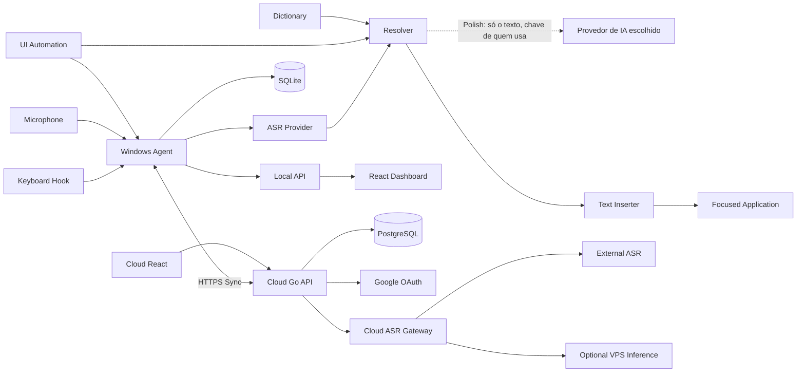

# System Design — Aurora Whisper

## Objetivo
Arquitetura local-first e cloud-connected. Windows executa captura, hotkey, contexto e inserção. Cloud fornece auth, sync, histórico global e gateway de ASR. ASR é substituível.

> **Emendado pela ADR-019 (01-out-2026), etapa 5.** A nuvem desta etapa fornece login, sync,
> histórico global, o app do celular (PWA, Android primeiro) e a lista de aparelhos. O **gateway de
> ASR**, o **resolve com contexto**, o **feed de atualização** e a inferência na VPS ficam para
> depois: as rotas não são montadas (diagrama abaixo: `GW`, `EXT` e `INF` são "depois"). A nuvem é
> opcional: sem quem usa conectar o PC, o Agent não abre conexão nenhuma.

> **Emendado pela ADR-021 (10-out-2026), ditar no celular.** O gateway de ASR (`/asr/transcribe`)
> continua fora. O celular ganha uma rota própria, `POST /api/v1/dictations`, que só repassa a voz
> (webm/opus, em memória, descartada ao fim) ao provedor que a pessoa escolheu (OpenAI ou Groq), com a
> chave dela guardada cifrada no servidor, e passa o texto pelo Smart da conta e, se ela ligar, pelo
> Polish. O ASR local do PC não muda. Ver `13-implementation-plan.md`, TASK-028.

## Diagrama


## Componentes
| Componente | Responsabilidade |
|---|---|
| Keyboard Hook | tap/hold global |
| Audio Engine | captura PCM em RAM |
| VAD | fala/silêncio e partial validation |
| Overlay | onda/estado |
| ASR Manager | provider/policy |
| Context Engine | UIA efêmero |
| Dictionary | termos/aliases/correções |
| Resolver | Literal/Smart/Polish |
| Text Inserter | UIA/clipboard |
| Local Store | SQLite/outbox |
| Sync Engine | push/pull |
| Local API | dashboard local |
| Cloud API | auth/sync/history/gateway |
| Cloud Store | PostgreSQL |
| Web | UI local/cloud |

## Hook
Usar `WH_KEYBOARD_LL`.

Fluxo:
1. `keydown` da tecla sem modifiers: suprimir, iniciar buffer e timer.
2. `keyup` antes do threshold: descartar buffer e sintetizar tap.
3. threshold expira: recording + overlay/beep.
4. `keyup` após hold: stop → processing → ASR → resolver → insert.
5. watchdog encerra sessão se keyup não chegar.

Com modifiers: bypass de ditado por default.

## Áudio
Camada nativa eficiente. Go pode usar binding WASAPI/miniaudio ou helper nativo, desde que `AudioSource` permaneça estável.
- mono;
- resampling centralizado;
- memória somente;
- nenhum temp file.

## VAD/partial
Durante gravação:
- detectar fala;
- amplitude do overlay;
- streaming/partial se provider suportar;
- partial não é inserido;
- pode aquecer pipeline.

## ASR provider
```go
type ASRProvider interface {
    ID() string
    Capabilities() ASRCapabilities
    Warmup(context.Context) error
    Transcribe(context.Context, AudioBuffer, ASROptions) (ASRResult, error)
}
```

`ASRResult` pode conter texto, idioma, timestamps, confidence, spans, alternatives, model e processing time.

Providers iniciais:
- `mock`;
- `local`;
- `cloud_gateway` (**depois**, ADR-019: não montado na etapa 5);
- `nuvem` (ADR-021, C4): `internal/asr/nuvem`, **no servidor**, para o ditado do celular. OpenAI ou
  Groq, escolhidos pela pessoa, com a chave dela, que chega por uma função a cada chamada. Só áudio
  comprimido (webm/opus): os bytes vão ao provedor como chegaram, sem decodificar, e o PCM é recusado
  (`asr.ErrPCMNaoSuportado`). Usa o mesmo contrato do `ASRProvider` (`AudioBuffer.Comprimido` e
  `ASRCapabilities.Formatos`; `18-tool-contract.md`). Não é uma `ASRPolicy` do PC.

Policies:
- `local_only`;
- `local_then_cloud`;
- `cloud_only`.

## Context Engine
Permitido:
- app/processo;
- tipo de controle;
- seleção;
- prefixo/sufixo próximos ao caret;
- labels acessíveis;
- window title só em memória se necessário.

Proibido:
- screenshot;
- OCR;
- leitura arbitrária de memória;
- password/protected control.

## Resolver

Smart:
```text
ASR
→ normalize
→ uncertainty
→ dictionary/aliases
→ phonetic/context scoring
→ self-correction
→ constrained cloud resolver se necessário
→ final text
```

Literal:
- ASR + normalização mínima.

Polish (ADR-016):
- Smart + preservar e organizar, opt-in (não é reescrita global);
- chamada direta do Agent ao provedor de IA escolhido (OpenAI ou Anthropic), com a chave de quem
  usa (BYOK), sem passar pelo backend cloud; só o texto final do Smart sai da máquina;
- prazo de 3,5 s por ditado (até 8 s no ditado longo, pelo tamanho do texto; ADR-016, emenda
  de 01-out-2026); passou disso ou falhou, entra o texto do Smart;
- preservar raw/final.

## Inserção
1. UI Automation quando suportado.
2. Clipboard fallback: snapshot → set text → paste → restore.
3. Se falhar, manter histórico e oferecer copiar.

Texto com quebra de linha (o Polish produz parágrafos e listas) vai **sempre pelo clipboard, com
`\r\n`**, nunca pelo `SendInput`: um `\n` curto pode virar Enter e enviar a mensagem num chat
(ADR-016; ADR-011, decisão 3).

## Local
SQLite armazena:
- transcriptions;
- dictionary/corrections;
- settings;
- outbox;
- sync cursor.
Nunca áudio/contexto.

> **Emendado pela ADR-017 (30-set-2026).** `dictionary/corrections` **não** moram no SQLite nesta
> etapa: o dicionário, inclusive o que o painel aprende, mora no `dicionario.json` ao lado do
> executável (a pessoa consegue abri-lo e ler), e a Correction não é guardada como registro à parte.
> As tabelas `local_dictionary_*` e `local_corrections` ficam **vazias e sem repositório** até a
> etapa 5, que traz o sync e a ida do dicionário para o banco. Conflito com esta seção resolvido pela
> ADR-017.
>
> **Emendado pela ADR-019 (01-out-2026).** A etapa 5 **não** leva o dicionário para o banco: o
> `dicionario.json` continua a fonte da verdade em cada PC, e do dicionário só sincroniza o aprendido
> no painel (o par curto, com a restrição e o nome do domínio). O SQLite guarda a base da última
> sincronização do aprendido, para a diferença em 3 vias (F8). O dicionário completo no banco fica
> para depois.

## Sync
- IDs globais.
- mutation_id.
- push idempotente.
- cursor monotônico.
- optimistic concurrency.
- delete aceito vence edit antiga.
- stale base_version retorna conflict.

Como fica na etapa 5 (ADR-019, "Contrato de sync, por usuário"):
- **Gravação única:** toda mudança, de qualquer porta (CRUD do celular, push do PC, retenção,
  "apagar meus dados"), grava a entidade e o evento na mesma transação (ADR-009).
- **Cursor por usuário:** o `seq` vem de um contador por usuário (`UPDATE … RETURNING`, o primeiro
  comando da transação). A ordem do `seq` é a ordem dos commits, sem buraco.
- **Pull pelo estado atual:** o pull devolve o estado atual de cada entidade mudada depois do cursor,
  mais as lápides; não devolve eventos com conteúdo.
- **Fila no PC:** um marcador por entidade; o texto é lido da linha na hora de enviar.
- **Conflito:** vale o que chegou primeiro; a versão que perdeu fica no item, com um selo, até a
  pessoa escolher. O aplicador do PC nunca sobrescreve item com marcador pendente.
- **`gone`, epoch e recomeço:** o que foi apagado não ressuscita de um PC parado, de um backup
  restaurado nem depois do "apagar meus dados". A nuvem não responde `410` por marca d'água
  (ADR-019, F9, D2): o `gone` basta, e o PC trata um `410` por robustez.
- **Retenção na nuvem (F9):** um job no processo do servidor, na subida e de hora em hora, por
  usuário; decide cada item em Go, pela data do ditado, e de novo sobre a linha travada; o ativo
  vencido sai sem lápide, a lixeira vencida dentro da janela deixa lápide e evento, e a lápide vive
  a janela mais um dia. Arruma também os eventos órfãos e as respostas antigas do push.
- **Recusa por regra não trava o cursor** ("não aplicado neste PC"); só erro de E/S trava.
- **Retenção pela data do ditado** que o PC mandou.

## Dashboard
Mesmo React bundle:
- local same-origin com Agent;
- cloud same-origin com backend.

> **Emendado pela ADR-019 (01-out-2026): mesmo código, dois builds.** O build local continua em
> `bin/painel`, sem service worker e sem login. O build da nuvem tem login, manifest e service worker
> (o app do celular). Os dois saem do mesmo código React, com a escolha por constante de compilação;
> a interface `Cliente` (`web/src/api.ts`) ganha a implementação da nuvem. O bundle local nunca
> registra service worker (um teste confere), e o Agent responde `404` em `/sw.js`.

## Device auth
1. Agent gera device/challenge.
2. Abre browser cloud.
3. Google OAuth.
4. Cloud associa device.
5. Agent troca verifier por device token.
6. Token no Windows Credential Manager.

> **Emendado pela ADR-019 (01-out-2026): retorno a `127.0.0.1` com PKCE (RFC 8252, §7.3), sem
> consulta repetida.** O fluxo com `poll_token` (`06`) era phishável (RFC 8628, §5.4). Como fica:
> 1. Quem usa clica em **Conectar à nuvem** no painel local; o Agent gera o verificador e chama
>    `device-auth/start` com o desafio, o nome do PC e a porta do painel local.
> 2. O Agent abre o navegador (atrás do portão `sysinput`) na página de aprovação da nuvem.
> 3. A página exige sessão (login Google), mostra o nome do PC e um código só de conferência, e
>    avisa para só aprovar se a pessoa clicou em Conectar agora.
> 4. Aprovar é um `POST`, que redireciona para `http://127.0.0.1:<porta>/nuvem/retorno` com `code` e
>    `state`.
> 5. O Agent troca o `code` com o verificador em `device-auth/exchange` e recebe o token.
> 6. Token no Gerenciador de Credenciais (`AuroraWhisper/nuvem`); a nuvem guarda só o HMAC.
>
> O token do PC só serve ao sync, ao `/me` e ao próprio aparelho. Revogar dá `401`, e o Agent segue
> local.

## Cloud ASR
**Depois (ADR-019):** na etapa 5 o áudio não sai do PC, e a rota não é montada.

Backend recebe áudio efêmero, valida limites, não grava, encaminha ao provider e retorna resultado.
Secrets do projeto ficam server-side. Exceção (ADR-016): a chave de API do provedor de IA de quem
usa (BYOK) fica no Gerenciador de Credenciais do Windows e só serve ao Polish, que **não passa
por este gateway**.

## Deploy
Containers:
- API;
- Postgres;
- inference opcional;
- reverse proxy integrado ao ambiente existente ou dedicado após revisão.

> **Emendado pela ADR-019 (01-out-2026).** Na etapa 5: um compose só do projeto, com a API e o
> Postgres numa rede própria; o Postgres não publica porta; sem inferência; sem CDN de terceiro na
> frente (o HTTPS termina no servidor). Com as portas 80 e 443 livres, um Caddy dedicado; com um
> proxy já rodando, integrar a ele é **ponto de parada** (muda um serviço em produção). Tudo depende
> do diagnóstico só de leitura do servidor (`scripts/diagnostico-servidor.sh`).

## Decisões
| ID | Decisão |
|---|---|
| DEC-001 | Go + React |
| DEC-002 | SQLite local + PostgreSQL cloud |
| DEC-003 | ASR por provider |
| DEC-004 | UIA sem screenshot |
| DEC-005 | Backend desde v1 |
| DEC-006 | Cloud gateway guarda os secrets do projeto. Exceção (ADR-016): a chave de quem usa (BYOK) fica no Gerenciador de Credenciais e só serve ao Polish |
| DEC-007 | Áudio em RAM apenas |
| DEC-008 | React compartilhado local/cloud. **Emenda (ADR-019):** o mesmo código, em dois builds (local, sem service worker nem login; nuvem, com os dois) |
| DEC-009 | Polish preserva e organiza, e o Agent chama o provedor direto, com a chave de quem usa (ADR-016) |
| DEC-010 | Nuvem e celular (ADR-019): PWA, Android primeiro; gravação única com o evento de sync na mesma transação; sync por usuário; login Google só para as contas permitidas; pareamento por retorno a `127.0.0.1` com PKCE |
| DEC-011 | Ditar no celular (ADR-021): o servidor só repassa a voz ao provedor da pessoa (OpenAI ou Groq, BYOK) e não transcreve; a chave dela fica cifrada no servidor (AES-256-GCM, HKDF); a voz só em memória, com aceite específico por conta; o Smart roda no servidor com o aprendido da conta; o Polish é o mesmo motor do PC (`internal/polish`). Emenda a DEC-006 e à regra "a chave nunca sai do PC" (ADR-016): elas valem para a chave **do PC**; a que a pessoa cola no app do celular é outra |

## Alternativas rejeitadas
- fixar Whisper antes de benchmark;
- inference VPS por default;
- screenshot;
- LLM reescrevendo tudo sempre (o Polish só preserva e organiza: ADR-016);
- gateway cloud para o Polish (ADR-016);
- banco somente local ou somente cloud;
- dois frontends separados (dois builds do mesmo código não são dois frontends: ADR-019);
- pareamento por consulta repetida (`poll_token`), phishável (ADR-019);
- CDN de terceiro na frente da nuvem, que leria o texto (ADR-019).
