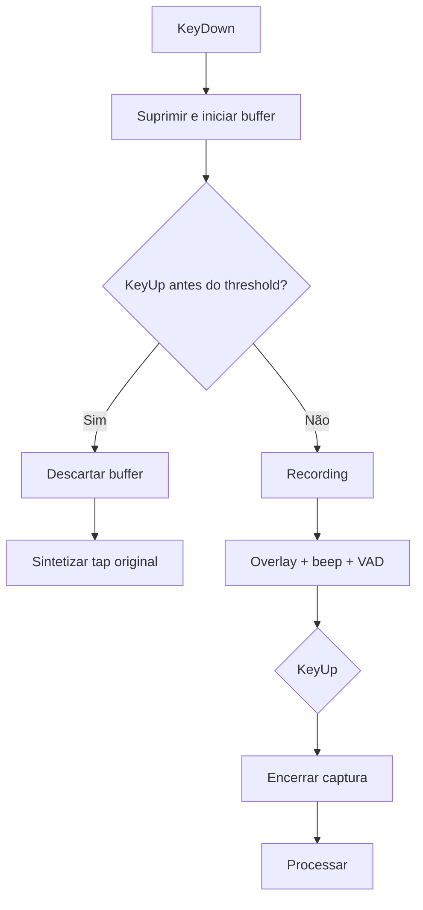
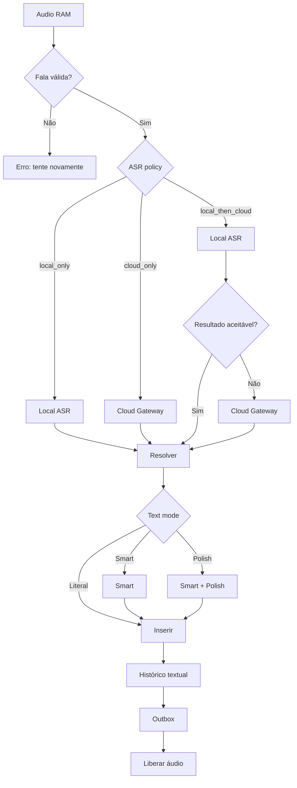
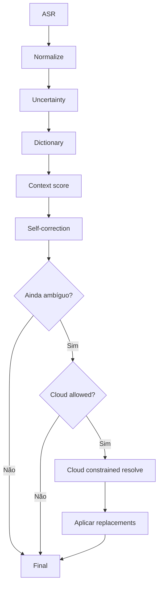
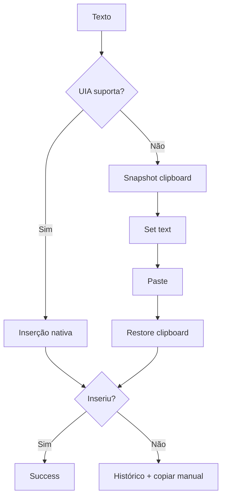
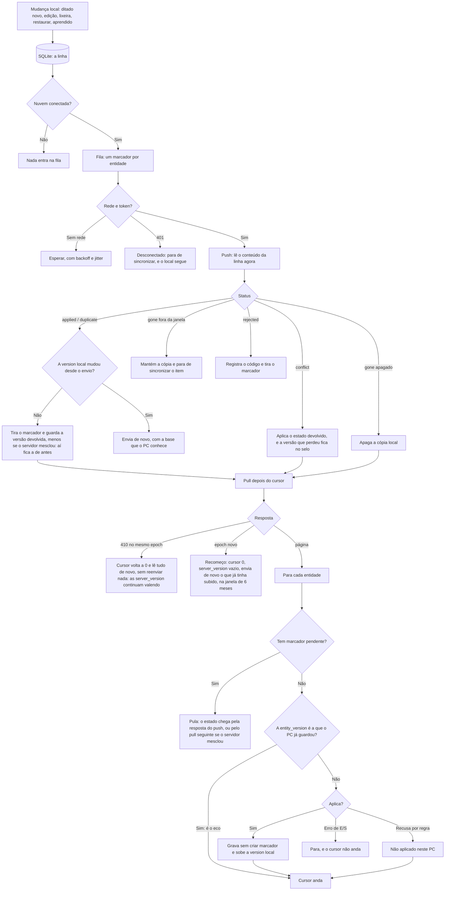
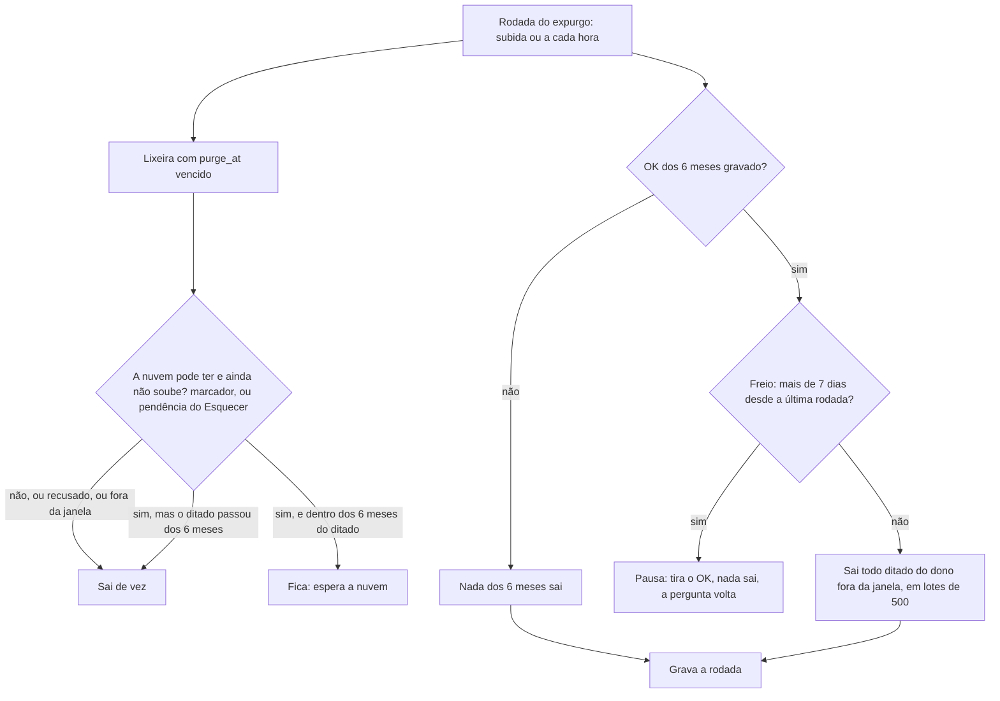

# Flows — Aurora Whisper

## Tap curto vs ditado


## Pipeline de transcrição
Na etapa 5 (ADR-019) só existe o ramo `local_only`: o gateway de ASR na nuvem fica para depois. A
"Outbox" do fim só recebe o marcador quando a nuvem está conectada (ver "Sync").


**Ditado feito dentro de uma nota (ADR-022).** O passo "Histórico textual" consulta o aviso de nota em
foco (só em memória, 60 s). Com aviso vivo e a inserção bem-sucedida, a linha é gravada com `virou_nota`
(o id da nota, ou `nova:<token>` no "Criar uma nota") e **não aparece** na lista do histórico; a
inserção em si não muda. Sem aviso, ou com a inserção falha, é o ditado de sempre. O "Aprender" e a
auditoria ainda leem o `raw_text`. Ver `06-api-contract.md`, "Nota em foco".

## Smart resolve
Na etapa 5 (ADR-019), "Cloud allowed?" é sempre "Não": o resolve com contexto na nuvem fica para
depois.


## Inserção


## Sync
Reescrito pela ADR-019 (01-out-2026). O desenho anterior (resolver o conflito com a mudança que
viesse no pull da mesma rodada, e travar o cursor em qualquer erro de aplicação) deixava conflito
parado para sempre e um item que não aplica travando o sync inteiro (`internal/sync/engine.go`).



Regras que o diagrama não mostra:
- **Envio inicial**, ao conectar: prévia da contagem, cópia do banco, os ditados dos últimos 6 meses
  sem a lixeira, em lotes limitados por número e por bytes. O recomeço do epoch novo usa o mesmo
  caminho (a fila e os lotes), para o que já tinha subido, também sem a lixeira (F7a/b, abaixo).
- **Conflito no servidor:** vale o que chegou primeiro; não é conflito a mesma mudança nem campos
  diferentes (lixeira × texto); apagar vence uma edição antiga, e a edição vai para o selo.
- **Eco e mescla:** o PC reconhece o eco pela versão (a `entity_version` é a que ele já guardou), nunca
  só pelo `device_id`. Quando o servidor mescla campos diferentes, o `applied` vem com
  `mesclado: true`, o PC não guarda a versão devolvida, e o estado mesclado chega no pull seguinte.
  Sem isso, a mudança de outro aparelho que um pull anterior pulou (o item tinha marcador) se perderia
  como eco (ADR-019).
- **Gravação única no servidor:** a entidade, o evento e a mutação aplicada na mesma transação, com o
  `seq` do contador do usuário (ADR-009).
- **Celular:** não usa o sync; lê e edita pelas rotas da nuvem, e a mudança chega ao PC pelo pull.
- **O que a F2 fixou no servidor (ADR-019, "Decisões da F2"):** a mudança de um ditado que já existe
  sobe só com o que o PC mudou desde a base (`final_text`, `deleted_at`); a lixeira é esse campo, e o
  `delete` de ditado é recusado. Uma edição de texto com base anterior à ida para a lixeira vai para o
  selo, e o item fica na lixeira; restaurar contra uma lixeira mais nova também não tira o item de lá.
  O `conflict` e o `applied` mesclado gravam sempre uma versão nova, que chega a todos pelo pull.
  Decisão que não grava nada não gasta `seq`. O PC (F7b) **não puxa entre um push sem resposta e o
  reenvio dele**: o `duplicate` não traz o estado, e uma versão pulada nesse meio se perderia nesse PC.
- **Revisão da F2 (05-out-2026), proposta a confirmar:** no reenvio com a base velha depois de um
  `applied` mesclado, o campo que o **próprio** PC mudou por último conta como conhecido por ele (o
  servidor guarda quem mudou o texto e a lixeira por último). Assim o PC que pôs na lixeira e logo
  restaurou, ou que editou duas vezes seguidas, não perde a segunda mudança para a primeira. A mudança
  de outro aparelho segue as regras de sempre.
- **O que a F7a e a F7b fixaram no PC (ADR-019, "Decisões da F7a/b", 06-out-2026):**
  - **A gravação:** o ditado novo, o texto que chega atrasado, a edição no painel, a lixeira e o
    restaurar põem o marcador na mesma transação da linha, com os campos que mudaram, e só se a linha
    mudou: com o aparelho na tabela `instalacao` (conectado), sempre; **desconectado, só num ditado
    que a nuvem já tem** (com `server_version`), para a mudança feita fora subir na volta com a base
    certa (revisão de 06-out-2026). Depois do commit, só acordam o laço (sem esperar nada). O expurgo
    leva o marcador junto. O aplicador nunca põe marcador. **A F7c restringiu o "conectado,
    sempre"** (revisão de 06-out-2026): num ditado que a nuvem não tem, só o ditado novo entra; a
    edição, a lixeira e o restaurar de um ditado do histórico ficam para o envio inicial e a
    completação (abaixo).
  - **A rodada:** primeiro o cursor deste pareamento (o pareamento novo da mesma instalação continua
    do cursor, com as versões que o PC guardou); depois o push, em lotes, até a fila esvaziar, com os
    em voo primeiro e os mesmos `mutation_id`; os ids são gravados antes da rede, e a resposta é
    aplicada numa transação. **Um push sem resposta encerra a rodada, sem pull.** Depois, o pull até
    `has_more` falso, cada página numa transação com o cursor. Nenhuma rede dentro de transação.
  - **Quando roda:** na subida do Agent, 2 s depois de uma gravação (para juntar as seguintes), a
    cada 60 s e ao conectar. Desconectado, nenhum pedido sai. **ADR-021, subfatia S (10-out-2026):** com
    o painel do PC aberto (alguém leu o contador de mudanças nos últimos 15 s), a busca periódica é a
    cada **10 s**; com ele fechado, volta aos 60 s. O painel visível lê o contador a cada 3 s e relê a
    lista quando ele muda (`06`, "A chegada mais rápida no PC").
  - **Quando falha:** a rede, o prazo ou um `5xx` esperam de 2 s a 5 min, com jitter, e as gravações
    não furam a espera; o `429` espera o `Retry-After` (até 10 min); uma resposta fora do contrato
    espera o teto; o `401` desconecta (o token sai do Gerenciador, o aparelho da instalação, o painel
    diz "Este PC foi desconectado na nuvem."), e o ditado segue local; o ditado novo não entra na
    fila, e a mudança num ditado que a nuvem já tem entra, para a volta.
  - **A volta** (revisão de 06-out-2026; ADR-019, "Decisões da F7a/b", decisão 2, confirmada pelo
    Mauro em 06-out-2026): no mesmo epoch, as `server_version` continuam valendo. **Reconectar** continua do cursor
    (só os envios em curso são esquecidos) e sobe a fila; **o `410`** só volta o cursor a 0 e lê
    tudo de novo, sem reenviar nada. Assim, um ditado que outro aparelho editou com o PC fora chega
    ao PC sem selo; a edição feita fora num ditado que ninguém mais mexeu vale; a que bate com uma
    edição de outro aparelho vira selo (de verdade); a lixeira feita fora sobe (apagar vence), e a
    lixeira antiga não volta a subir (um restaurar mais novo, no celular, fica).
  - **O recomeço** (só o epoch novo, um backup restaurado, e a primeira rodada da instalação): cursor
    0 e epoch nulo; os envios em curso esquecidos; um marcador para cada ditado que a nuvem já tinha,
    na janela de 6 meses, fora da lixeira e não posto fora dela, e `server_version` nulo em todos; a
    rodada roda de novo (uma vez). O que nunca subiu fica para o envio inicial (F7c), que deixa a
    lixeira de fora; a lixeira daqui que a nuvem não tem sobe pela reconciliação do pull (F7c). Com a base vazia, a nuvem compara contra tudo: o ditado cujo texto difere do que
    ela tem e cujo último texto veio de outro aparelho vira selo, e um selo pendente pode ser trocado
    (o risco fica com a F11, que restaura backups).
  - **A bandeja** mostra uma linha desabilitada: "Nuvem: em dia", "Nuvem: N para enviar", "Nuvem:
    sem conexão", "Nuvem: aguardando" (o `429`), "Nuvem: resposta inesperada" (a nuvem no ar, fora do
    contrato) ou "Nuvem: desconectada" (nada, sem nuvem configurada).
- **O que a F7c fixou no PC (ADR-019, "Decisões da F7c", 06-out-2026):**
  - **O envio inicial** (resposta 3; D1: com um clique). Conectado, depois da primeira rodada que deu
    certo com esta conexão (o pull do 0 já trouxe, e reconciliou, o que a nuvem tem), a seção Nuvem
    pergunta: "Vão subir N ditados dos últimos 6 meses. A lixeira não vai. Antes, uma cópia do
    histórico fica neste PC." O clique em **Enviar o histórico**: (1) a cópia do banco, `VACUUM INTO`
    ao lado dele (`historico.db.antes-da-nuvem-AAAAMMDD-HHMMSS.db`), pela conexão única do Agent, que
    a segura entre a contagem e a cópia (o ditado que chegue nesse tempo só espera), conferida tabela
    por tabela; uma por conta; se falha, nada é marcado; (2) os marcadores de criar dos elegíveis (do
    dono, sem a versão da nuvem, fora da lixeira, sem recusa, nascidos neste PC, nos 6 meses), em
    blocos de 500 por transação, contados no total do progresso; (3) o aceite; e o laço acorda. A fila
    os leva nos lotes de sempre (500 mutações, 512 KiB), por último: o ditado feito durante o envio
    passa na frente. O `429` do limite da nuvem é só espera. Sem nada elegível, não há cópia nem
    pergunta: a rodada grava o aceite sozinha.
  - **A completação:** depois do aceite, toda rodada (logo depois do cursor) marca o que ficou de fora
    (o ditado novo feito desconectado, o restaurado), sem cópia nem pergunta.
  - **O histórico que a nuvem não tem, mexido com o PC conectado** (revisão de 06-out-2026): a
    edição, a lixeira e o restaurar não o põem na fila (antes punham, e ele subia antes do clique e
    sem a cópia; o posto na lixeira ia para a lixeira da nuvem). Só o `Put` do ditado novo põe. A
    lixeira tira da fila o marcador de criar que ainda não saiu (o do ditado novo e o do envio
    inicial, que conta como feito no progresso); o em voo fica (a nuvem pode já ter o ditado), e o
    reenvio dele leva a lixeira: o ditado termina na lixeira da nuvem, criado já nela se o primeiro
    envio não chegou (risco aceito na reconferência de 06-out-2026). O
    restaurado sobe pela completação, na rodada seguinte.
  - **O progresso:** o painel diz "Enviando o histórico: 120 de 800." (relido a cada 2 s, só enquanto
    envia e com a seção à vista) e, no fim, "O histórico subiu para a nuvem." (com quantos não
    subiram, o que a linha de "em dia" continua dizendo); a bandeja diz "Nuvem: enviando 120 de 800"
    (também no `429`; sem rede, vence "Nuvem: sem conexão").
  - **A reconciliação do pull (D3):** um ditado que existe aqui sem a versão da nuvem, sem marcador,
    que mudou aqui (depois do esquecer, ou antes dele sem a nuvem receber, anotado pelo esquecer; sem
    esquecer, sempre) e em que o lado do PC pode vencer (outro
    texto, ou na lixeira só aqui) não é sobrescrito: sobe inteiro, com a base vazia, numa volta a mais
    da rodada, e a nuvem decide (apagar vence; texto contra texto vira selo). O que não mudou aqui, o
    igual e o que só difere porque a nuvem o pôs na lixeira recebem o estado da nuvem (sem selo à
    toa, e sem reconciliar a cada rodada). Fecha o risco da F2: o epoch novo não tira da lixeira o
    que o PC pôs lá.
  - **O selo no PC:** o mesmo componente do app; a escolha vale na hora no PC (só na versão atual e com
    selo) e, num ditado que a nuvem tem, entra na fila (também desconectado) e sobe pelo push com o
    `conflict_at` do selo. Na nuvem, ela vale sobre o mesmo selo e sem o texto mudado depois; senão
    cai, vale o que chegou primeiro, e o pull traz o estado de volta (o selo também, se ainda existe).
  - **O "Esquecer esta nuvem"** (Configurações > Nuvem, desconectado): a pergunta na linha, e depois,
    numa transação, saem a URL, a conta, o aparelho, o envio e a cópia registrada (o arquivo fica), o
    cursor, a fila inteira e, nas linhas, só o que é do sync; o token sai do Gerenciador, se ainda
    estiver lá. Os ditados ficam. Depois, a D3 deixa conectar a outra nuvem ou conta, e o histórico só
    sobe com o clique, com uma cópia nova; o que veio de outro PC nunca sobe deste (D2). De volta à
    mesma conta, o que a nuvem já tem é reconciliado, sem duplicar, e a mudança feita aqui que estava
    na fila na hora do esquecer não é desfeita pelo pull: o esquecer a anota, item por item
    (`sync_mudou_aqui`), e ela sobe com a base vazia (revisão de 06-out-2026; na reconferência do
    mesmo dia, a anotação trocou o recuo da referência, que pegava também o ditado recebido da nuvem
    nesse meio e o deixava virar selo à toa). Uma resposta que chega depois de
    o PC desconectar, esquecer ou reconectar (o pedido estava na rede) não é aplicada, e a rodada só
    termina: nada de recomeço com o aparelho velho.

## Device auth
Reescrito pela ADR-019 (01-out-2026): retorno a `127.0.0.1` com PKCE (RFC 8252, §7.3). O desenho
anterior (`start` com `poll_token` e consulta repetida até a aprovação) é phishável: quem começa o
pedido manda o link, e recebe o token depois do clique de quem está logado (RFC 8628, §5.4).

```mermaid
sequenceDiagram
    participant P as Painel local (Agent, 127.0.0.1)
    participant B as Navegador
    participant C as Nuvem
    participant G as Google
    P->>P: Conectar à nuvem (clique de quem usa): confere a URL antes da rede, gera o verificador do PKCE
    P->>C: POST /api/v1/device-auth/start(install_id, nome do PC, versão, desafio S256, porta do painel)
    C-->>P: pedido (o state) + código de conferência + prazo (10 min)
    P->>B: abre {URL digitada}/device/authorize?pedido=… (atrás do portão sysinput; o auth_url da resposta é ignorado)
    B->>C: GET /device/authorize (o app)
    alt sem sessão
        C-->>B: tela Entrar
        B->>C: POST /auth/start (volta = /device/authorize?pedido=…)
        C-->>B: cookie __Host-pre + URL do Google
        B->>G: login (openid email profile)
        G-->>B: redireciona para o callback
        B->>C: GET /auth/google/callback (state, code)
        C->>C: confere state e pre, valida o ID token, confere a lista permitida
        C-->>B: cookie __Host-sessao, volta para /device/authorize?pedido=…
    end
    B->>C: GET /api/v1/device-auth/requests/{pedido}
    C-->>B: nome do PC, código de conferência
    B->>B: "Conectar este PC?", o código, a conta da sessão e "Só aprove se você clicou em Conectar neste PC agora."
    B->>C: POST /api/v1/device-auth/requests/{pedido}/approve (fetch, sessão + CSRF)
    C-->>B: { retorno: http://127.0.0.1:porta/nuvem/retorno?code&state }
    B->>P: location.replace(retorno): GET /nuvem/retorno (code, state)
    P->>P: confere o state (tempo constante) e o prazo; consome o pedido (uso único)
    P->>C: POST /api/v1/device-auth/exchange(code, verificador)
    C->>C: acha o pedido pelo hash do code E pelo desafio (verificador errado não queima o code)
    C-->>P: device_id + token + conta (a nuvem guarda só o HMAC)
    P->>P: D3 (outra conta: revoga o aparelho novo e para); token no Gerenciador de Credenciais (alvo do modo); conta e aparelho na tabela instalacao
    P-->>B: página fixa "PC conectado"
    Note over P: o painel, ao voltar à aba, mostra "Conectado como …"
```

O alvo do token no Gerenciador de Credenciais é `AuroraWhisper/nuvem` no Agent instalado e
`AuroraWhisper/nuvem-portatil` no `bin\` (modo portátil). **F6 (05-out-2026):** o diagrama acima é o
que o código faz; o `303` do formulário do desenho anterior virou o `fetch` com o `retorno` em JSON
(ADR-019, "Decisões da F6").

Revogar (pelo celular ou pelo navegador, em Configurações > Aparelhos): o token passa a receber `401`,
e o Agent, na próxima conferência (ao abrir as Configurações do PC ou ao voltar à aba, no máximo a
cada 30 s), apaga o token daqui e mostra "Este PC foi desconectado na nuvem."; segue ditando e
guardando localmente. Desconectar pelo PC tenta revogar o próprio aparelho na nuvem (`DELETE
/api/v1/devices/{id}` com o token, 5 s) e **sempre** apaga o token local; sem a confirmação da nuvem,
diz para revogar em Aparelhos. Sem o token (desinstalado apagando os dados, ou apagado à mão), o PC
aparece desconectado, e o aparelho continua na lista da nuvem até alguém revogá-lo ou passarem 180
dias sem uso.

## Login no celular (ADR-019)
1. O app instalado abre em `/`; sem sessão, mostra **Entrar**.
2. **Entrar** chama `POST /auth/start`, que grava o cookie `__Host-pre` e devolve a URL do Google.
3. No Android, o Google abre numa Custom Tab que divide os cookies com o app instalado; o callback
   encontra o cookie `pre` e cria a sessão (`__Host-sessao`).
4. Conta fora de `CONTAS_PERMITIDAS`: "Esta conta não tem acesso a esta nuvem." Nada é criado.
5. **iPhone, depois do MVP:** se o cookie `pre` não voltar, a página de retorno mostra um código de 6
   dígitos, que a pessoa digita no app.

## Learning
Como ficou na ADR-017 (30-set-2026). Fatias F1 a F4: o motor de sugestão (`internal/learning`,
`Sugerir`), gravar e desfazer (`internal/dictionary`, `cmd/agent`), as rotas da API local
(`internal/agent/localapi`) e o aviso e a lista do painel (`web/src`) estão implementados. O que não
foi provado é o laço ponta a ponta com um ditado de verdade: é o roteiro manual de `ADR-017`.

1. Editar final_text no painel.
2. Salvar edição. O Agent lê o texto **como estava antes** e grava a edição (conflito de versão: `409`,
   sem sugestão). **Salvar nunca grava no dicionário.**
3. Comparar o texto de antes com o salvo, o que separa o que a pessoa mudou do que o sistema (Smart,
   Polish) já tinha mudado sozinho. Comparação sem maiúscula, acento e pontuação.
4. Alinhar cada troca com o **`raw_text`**, para achar a forma que o ASR escreveu: o "de" é sempre do
   bruto (decisão de 28-set-2026).
5. Filtrar: só vira sugestão a **troca curta de termo** (até 4 palavras e 30 letras de cada lado).
   Ficam de fora pontuação, quebra de linha, maiúscula ou acento sozinhos, reescrita (mais de 4
   palavras, só acrescentar ou só apagar, mais de 2 trocas), número (inclusive grudado em letra, como
   "10h" para "11h", e por extenso, como "oito" para "seis"), palavra de ligação (nem a junção ou a
   separação dela, como "se não" para "senão" ou "a nota" para "anotar"), negação, afirmação ou
   quantificação ("não" para "sim"), o desfazer de uma troca que o próprio sistema fez e variante que
   já é de outro termo. Quando a troca conserta só um pedaço de um termo que o dicionário já tem ("EFD
   rain" para "EFD-Reinf"), a sugestão é o termo inteiro; a maiúscula de começo de frase não entra no
   termo novo, a não ser que o texto mostre que é um nome. Devolve **até 2 sugestões** na resposta de
   salvar.
6. Usuário confirma com o clique em **Aprender** (se o aviso some, a sugestão foi ignorada). O Agent
   refaz as checagens contra o bruto daquele ditado.
7. Gravar como **variante** do termo (criado com prioridade 50 se não existe), no `dicionario.json`,
   com a origem `"painel"`, e trocar o dicionário em memória: vale no **próximo ditado**, sem
   reiniciar. O prompt do ASR é remontado do arquivo relido em toda gravação do painel
   (`gravarETrocar`, ADR-020, decisões 5 e 6), mas o Aprender não o muda: a variante não entra nele, e o
   termo que o painel cria é `AliasOnly`, que a `DisputaOPrompt` tira do prompt (a prioridade 50 não
   é o que o tira).
8. **Desfazer** (no aviso e na lista de Configurações) remove a variante.
9. Sync: **etapa 5.** A Correction que sincroniza (TEST-008) e a ida para o banco não fazem parte da
   etapa 3. **ADR-019, "Decisões da F8" (07-out-2026):**
   - sobe só a troca do botão Aprender, a variante de origem `"painel"`, com o termo, a restrição e o
     domínio (D1). O "Adicionar termo" (o termo, as grafias `"adicionado"` e a dica), o que a pessoa
     pôs à mão e o que o `dictlearn` pôs ficam em cada PC;
   - nada aprendido sobe antes do clique em "Enviar o histórico" (D3); a pergunta conta as trocas
     ("N ditados e M trocas aprendidas", também com N = 0). Depois do clique, a troca sobe sozinha;
   - a troca chega sozinha aos outros PCs, sem clique lá (D2). O PC que recebe refaz as checagens do
     Aprender e nunca a deixa valer em mais lugares do que na origem. Se não tem a palavra, cria como o
     Aprender faz (prioridade 50, `AliasOnly`, sem domínio, fora do prompt); o que não vale ali fica
     "não aplicado neste PC", com o motivo. O aplicador também remonta o prompt (o `gravarETrocar`);
   - no desacordo, vale o primeiro que chegou à nuvem, e o desfazer vence (D4); o PC que perdeu segue a
     nuvem e mostra uma etiqueta ("desfeito em outro aparelho" ou "trocado em outro aparelho");
   - o celular vê a lista e desfaz (o Desfazer vale em todos os PCs); aprender continua só no PC.

O diff palavra a palavra do painel (o passo 3 da versão anterior, "para UX") continua só como
desenho da tela; o motor que sugere é outro código.

Edição grande nunca vira alias silenciosamente. **Nada vira alias sem o clique.** (O clique é no PC
de origem: o par aprendido chega sozinho aos outros PCs, que refazem as checagens do Aprender;
ADR-019, "Decisões da F8", D2.)

## Delete
- manual → trash + 30d;
- restore antes do purge;
- active >6m → purge definitivo.

Na nuvem (ADR-019): os prazos contam pela data do ditado que o PC mandou; "excluir definitivamente"
e a lixeira vencida deixam uma lápide enquanto o ditado estiver na janela de 6 meses; "apagar meus
dados" apaga tudo da conta, troca o epoch e revoga os aparelhos.

No PC (ADR-019, "Decisões da F10", implementada em 08-out-2026), o ciclo do expurgo roda na subida e
de hora em hora, sempre com o mesmo `agora` na rodada inteira:



- **A lixeira espera a nuvem (D3):** o ditado posto na lixeira com a nuvem ainda sem saber (o PC
  desconectado, a mudança na fila, a pendência anotada pelo "Esquecer esta nuvem") fica além dos 30
  dias até a nuvem saber, no máximo até o ditado completar 6 meses. Num PC que nunca conectou, são os
  30 dias; o ditado que a nuvem recusou sai aos 30 dias. Na rodada em que o freio dispara, o teto da
  janela não libera ninguém (fica mais uma rodada).
- **Os 6 meses, atrás do OK:** o bloco **Histórico** das Configurações mostra a contagem; o OK pergunta
  de novo na própria linha, com o número que a pessoa viu. O Agent reconta (se mudou, recusa com o
  número novo; sem nada a apagar, recusa), copia o banco
  (`historico.db.antes-dos-6-meses-AAAAMMDD-HHMMSS.db`, uma só) e confere a cópia, e grava o OK na
  mesma transação do primeiro lote. Daí em diante, o que completar 6 meses sai sozinho, em até 1 h.
  **Desligar** tira o OK (o que saiu não volta). As linhas de outro dono e o aprendido ficam.
- **As cópias** ao lado do banco só saem pelo botão **Apagar as cópias**, com a pergunta na linha; a
  do envio do histórico à nuvem que ainda não terminou fica.

## Estados da sessão
- idle
- primed
- recording
- processing
- inserting
- success
- error
- blocked

## Timeouts
- primed = threshold;
- recording max default sugerido 120 s;
- local/cloud ASR com timeout proporcional ao áudio: 5 s + 0,75 × duração, entre 10 s e 90 s
  (`dictation.PrazoDeTranscricao`; ADR-007, nota de 2026-10-01; `docs/defeito-ditado-longo.md`);
- resolve com timeout proporcional ao texto: 5 s até 250 caracteres, mais 6 ms por caractere
  acima disso, até 9,5 s (`dictation.PrazoDeResolucao`; ADR-007, segunda nota de 2026-10-01);
- Polish com prazo 1,5 s menor que o do resolve, pelo mesmo texto: 3,5 s até 250 caracteres, até
  8 s aos 1000; passou do prazo, entra o texto do Smart (`winruntime`, que usa `polish.Prazo`, do
  pacote `internal/polish`; era o `prazoPolish` do `winruntime` até a C5a da ADR-021; ADR-016, "Emenda
  de 01-out-2026"; `docs/defeito-ditado-longo.md`, decisão 5);
- sync com exponential backoff + jitter.
